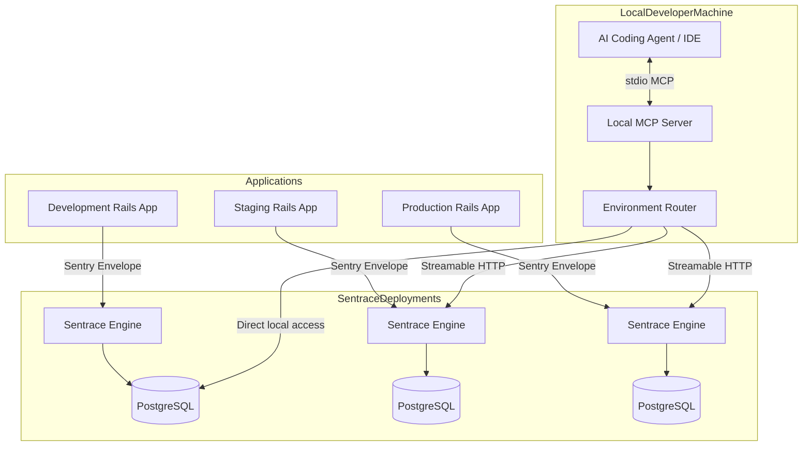

# Sentrace

**Sentry-compatible error tracking for Rails, with a federated MCP interface.**

- Gem: `sentrace`
- Engine namespace: `Sentrace`
- Rails Engine: `Sentrace::Engine`
- Database: PostgreSQL
- License: MIT
- Product category: Self-hosted application error tracking
- Primary interface: MCP
- Secondary interface: Rails ingestion API

---

## 1. Product vision

Sentrace is a self-hosted error tracking backend for Ruby on Rails applications.

It accepts application errors through the Sentry envelope ingestion protocol, stores normalized error events in PostgreSQL, groups related events into issues, and exposes the resulting data through the Model Context Protocol (MCP).

Developers can connect their preferred AI coding agents to a single local MCP server that federates error information across development, staging, and production environments.

Sentrace aims to provide a lightweight, Rails-native alternative to hosted error tracking services.

### 1.1 Core principles

1. **Self-hosted:** Application telemetry remains in infrastructure controlled by the application owner.
2. **Rails-native:** Distributed as an isolated Rails Engine with engine-owned database tables.
3. **Sentry-compatible:** Existing Sentry SDK integrations can send error events using a familiar DSN configuration.
4. **Storage-conscious:** Persist only information useful for error investigation.
5. **MCP-first:** Make application errors accessible to developers and AI coding agents.
6. **Environment-aware:** Support local development, staging, and production through a federated MCP architecture.
7. **Host-agnostic identity:** The host application owns user authentication and authorization.

### 1.2 Goals

- Accept Sentry-compatible error envelopes.
- Integrate with the official `sentry-ruby` SDK.
- Persist error events in PostgreSQL.
- Group related events into issues.
- Support project, environment, and release attribution.
- Expose issue and event data through MCP.
- Support local stdio and remote Streamable HTTP MCP transports.
- Federate multiple environments through one local MCP server.
- Provide basic issue lifecycle management.
- Keep database growth predictable through bounded event payloads and retention policies.

### 1.3 Non-goals for MVP

The initial release will exclude:

- Performance monitoring and transaction tracking.
- Span and distributed tracing storage.
- Metrics and metric aggregation.
- Session replay.
- User feedback widgets.
- Browser-side instrumentation.
- Log aggregation.
- Uptime monitoring.
- Alerting and notification delivery.
- A full Sentry dashboard replacement.
- External object storage integrations.
- Attachments and screenshots.
- AI-powered automatic root-cause analysis.

These capabilities may be considered after the core error tracking workflow proves useful.

---

## 2. Product architecture

Sentrace consists of three primary components.

1. Rails Engine: ingestion, persistence, issue grouping, and project management.
2. MCP Server: local stdio server and remote Streamable HTTP endpoint.
3. Environment Router: federates multiple Sentrace deployments into one developer-facing MCP interface.

### 2.1 High-level architecture



### 2.2 Deployment responsibilities

Every Rails deployment owns:

- Its own Sentrace database records.
- Its own projects and DSN credentials.
- Its own issue grouping.
- Its own ingestion endpoint.
- Its own remote MCP endpoint.

The local development environment acts as the federation entry point.

Remote environments expose authenticated MCP endpoints. The local MCP server connects to them using environment-specific URLs and credentials.

The router merges results and preserves environment attribution.

There is no centralized telemetry database.

### 2.3 Rails Engine isolation

The gem must use:

```ruby
module Sentrace
  class Engine < ::Rails::Engine
    isolate_namespace Sentrace
  end
end
```

All database tables must use the `sentrace_` prefix.

Sentrace owns its domain models and persistence. The host application owns its existing user models, authentication system, authorization policies, and infrastructure.

Sentrace must not require Devise, a particular authentication framework, or a specific frontend framework.

---

## 3. Technology requirements

| Component | Requirement |
|---|---|
| Ruby | >= 3.2 |
| Rails | >= 7.1 |
| Database | PostgreSQL >= 15 |
| Database adapter | Active Record |
| MCP protocol | MCP Streamable HTTP and stdio |
| JSON serialization | Ruby standard JSON library |
| Background processing | Optional Active Job integration |
| Asset storage | None required for MVP |
| Frontend | None required for MVP |

PostgreSQL is the only supported database for the initial release.

---

## 4. Sentry-compatible ingestion

### 4.1 Compatibility objective

Sentrace implements the Sentry envelope ingestion protocol for error events.

The official `sentry-ruby` SDK must be usable through a standard DSN configuration.

Example host application configuration:

```ruby
Sentry.init do |config|
  config.dsn = ENV.fetch("SENTRY_DSN")
  config.environment = Rails.env
  config.release = ENV["APP_RELEASE"]
end
```

The DSN points to the Sentrace installation.

Example:

```text
https://PUBLIC_KEY@errors.example.com/PROJECT_ID
```

### 4.2 Ingestion endpoints

Primary endpoint:

```http
POST /api/:project_id/envelope/
```

The endpoint accepts Sentry envelopes with the standard envelope header and item structure.

A legacy store endpoint is outside the initial compatibility target.

### 4.3 Supported envelope items

| Item type | MVP behavior |
|---|---|
| event | Parse and persist |
| attachment | Discard |
| session | Discard |
| sessions | Discard |
| transaction | Discard |
| client_report | Discard |
| profile | Discard |
| replay_event | Discard |
| replay_recording | Discard |
| Unknown types | Discard |

The envelope parser must safely process multiple items in a single request.

Unsupported items must not generate database records.

The ingestion response must follow the expected Sentry envelope response behavior closely enough for supported SDK integrations.

### 4.4 Event normalization

Convert supported event payloads into a normalized internal representation.

Supported event fields:

- Event ID.
- Timestamp.
- Platform.
- Level.
- Logger.
- Message.
- Exception type.
- Exception value.
- Stack trace.
- Breadcrumbs.
- Tags.
- Selected contexts.
- Release.
- Environment.
- Culprit.
- Request URL and HTTP method.
- Sanitized user identifier.

Fields outside the supported schema may be discarded.

### 4.5 Payload limits

The ingestion layer must enforce configurable limits before database persistence.

Initial defaults:

| Field | Maximum |
|---|---:|
| Envelope request | 1 MB |
| Message | 4 KB |
| Stack frames | 50 |
| Breadcrumbs | 20 |
| Tags | 32 |
| Tag key | 64 bytes |
| Tag value | 256 bytes |
| Context entries | 16 |
| Context serialized size | 8 KB |

Oversized fields must be truncated or discarded according to field semantics.

Requests exceeding the envelope limit must receive an appropriate client error.

### 4.6 Event deduplication

Each event carries a Sentry event ID.

The database must enforce uniqueness on:

```text
(project_id, event_id)
```

Repeated ingestion of the same event must not create duplicate records or increment issue occurrence counts.

---

## 5. Storage architecture

Storage efficiency is a first-class requirement.

Sentrace should retain enough information to investigate exceptions while avoiding the storage patterns associated with full observability platforms.

### 5.1 Storage policy

The MVP stores:

- One row per accepted error event.
- One row per grouped issue.
- Small project and credential records.
- Minimal release and environment attribution.

The MVP does not create rows for metric calls, spans, transactions, sessions, or unsupported envelope items.

An application emitting thousands of performance metric calls must not cause proportional growth in Sentrace tables.

### 5.2 PostgreSQL design principles

1. Use relational columns for frequently queried attributes.
2. Use JSONB for bounded, selectively retained event context.
3. Avoid storing the complete original envelope.
4. Avoid duplicate serialized representations of the same event.
5. Avoid indexing arbitrary JSONB fields.
6. Avoid a separate database row for every breadcrumb, tag, or stack frame.
7. Keep issue occurrence counters on the issue record.
8. Use explicit event retention policies.
9. Avoid PostgreSQL table partitioning until actual workload measurements justify it.

### 5.3 Database schema

#### `sentrace_projects`

Represents an application registered with Sentrace.

| Column | Type | Constraints |
|---|---|---|
| id | bigint | Primary key |
| name | varchar(120) | Not null |
| slug | varchar(120) | Unique, not null |
| created_at | timestamptz | Not null |
| updated_at | timestamptz | Not null |

#### `sentrace_project_keys`

Stores DSN credentials.

| Column | Type | Constraints |
|---|---|---|
| id | bigint | Primary key |
| project_id | bigint | Foreign key |
| public_key | varchar(64) | Unique, not null |
| secret_digest | varchar(255) | Nullable |
| active | boolean | Default true |
| created_at | timestamptz | Not null |
| revoked_at | timestamptz | Nullable |

Only a digest of secret credentials may be persisted.

Public keys identify ingestion projects. They must not be treated as sufficient authorization for MCP access.

#### `sentrace_issues`

Represents a group of related error events.

| Column | Type | Constraints |
|---|---|---|
| id | bigint | Primary key |
| project_id | bigint | Foreign key |
| fingerprint | varchar(64) | Not null |
| status | smallint | Not null |
| level | smallint | Not null |
| exception_type | varchar(255) | Nullable |
| message | varchar(1024) | Nullable |
| first_seen_at | timestamptz | Not null |
| last_seen_at | timestamptz | Not null |
| event_count | bigint | Default 0 |
| created_at | timestamptz | Not null |
| updated_at | timestamptz | Not null |

Statuses:

```ruby
enum :status, {
  unresolved: 0,
  resolved: 1,
  ignored: 2
}
```

Unique constraint:

```text
(project_id, fingerprint)
```

The fingerprint must be deterministic within a project.

Environment is excluded from the default fingerprint so an issue can be correlated across environments.

#### `sentrace_events`

Stores individual error occurrences.

| Column | Type | Constraints |
|---|---|---|
| id | bigint | Primary key |
| project_id | bigint | Foreign key |
| issue_id | bigint | Foreign key |
| event_id | char(32) | Not null |
| occurred_at | timestamptz | Not null |
| received_at | timestamptz | Not null |
| environment | varchar(64) | Nullable |
| release | varchar(128) | Nullable |
| platform | varchar(32) | Nullable |
| level | smallint | Not null |
| logger | varchar(128) | Nullable |
| culprit | varchar(512) | Nullable |
| event_data | jsonb | Not null, default `{}` |
| created_at | timestamptz | Not null |

Unique constraint:

```text
(project_id, event_id)
```

`event_data` contains bounded structured context:

```json
{
  "exception": {
    "type": "ActiveRecord::RecordNotFound",
    "value": "Couldn't find Order with ID=123",
    "frames": [
      {
        "filename": "app/services/orders/find.rb",
        "function": "call",
        "lineno": 42,
        "in_app": true
      }
    ]
  },
  "message": null,
  "request": {
    "url": "/orders/123",
    "method": "GET"
  },
  "breadcrumbs": [],
  "tags": {
    "component": "checkout"
  },
  "contexts": {
    "runtime": {
      "name": "ruby",
      "version": "3.4.0"
    }
  },
  "user": {
    "id_hash": "..."
  }
}
```

The example illustrates the internal normalized representation. The actual payload must be sanitized and bounded before insertion.

The original raw envelope is discarded after processing.

### 5.4 Index strategy

Initial indexes:

```sql
CREATE UNIQUE INDEX index_sentrace_issues_on_project_fingerprint
ON sentrace_issues (project_id, fingerprint);

CREATE INDEX index_sentrace_issues_on_project_status_last_seen
ON sentrace_issues (project_id, status, last_seen_at DESC);

CREATE UNIQUE INDEX index_sentrace_events_on_project_event_id
ON sentrace_events (project_id, event_id);

CREATE INDEX index_sentrace_events_on_issue_occurred_at
ON sentrace_events (issue_id, occurred_at DESC);

CREATE INDEX index_sentrace_events_on_project_occurred_at
ON sentrace_events (project_id, occurred_at DESC);
```

Avoid:

- GIN indexes over the complete `event_data` column.
- Indexes over every tag.
- Separate indexes for fields rarely used in queries.
- Duplicate indexes created by overlapping composite indexes.

Additional indexes require workload evidence.

### 5.5 Why this schema

The schema deliberately avoids a fully normalized representation of event internals.

A separate table for breadcrumbs, tags, stack frames, or context entries would multiply writes and create additional indexes and foreign keys.

These structures are bounded and primarily retrieved with their parent event. Keeping them together in JSONB is a better MVP trade-off.

PostgreSQL can store large JSONB values using TOAST compression and out-of-line storage. This helps with larger event payloads, although actual storage consumption must still be benchmarked.

### 5.6 Issue grouping

Issue grouping uses a deterministic fingerprint.

Initial grouping inputs:

1. Exception class.
2. Normalized in-application stack frames.
3. Exception message when no useful stack frames exist.

The grouping algorithm must:

- Exclude volatile values such as line-specific request IDs.
- Normalize application paths.
- Ignore framework frames when useful application frames exist.
- Produce a stable SHA-256 fingerprint.
- Support explicit fingerprints supplied by the Sentry event when available.
- Remain deterministic across application restarts.

The grouping implementation must be independently testable.

Concurrent ingestion of identical fingerprints must create one issue.

Use database uniqueness constraints and transactional upserts to prevent duplicate issues and lost occurrence increments.

### 5.7 Event retention

Default retention:

```ruby
config.retention_period = 30.days
```

Retention must be configurable.

Expired events are deleted in batches.

Deleting an event must not immediately delete its issue.

An issue with no remaining events may be deleted after a configurable orphan retention period.

Retention execution should use Active Job or an exposed rake task.

The gem must not require Redis or a specific background job adapter.

### 5.8 Storage observability

Expose internal storage statistics through administrative queries:

- Total events.
- Total issues.
- Events received per day.
- Approximate database storage size.
- Oldest retained event.
- Events removed by retention.

Do not persist individual metric observations to calculate these values.

Use PostgreSQL metadata and aggregate queries.

---

## 6. Privacy and data protection

Error events frequently contain sensitive information.

Sentrace must apply sanitization before persistence.

### 6.1 Default exclusions

Do not persist:

- Request bodies.
- Request cookies.
- Authorization headers.
- Session tokens.
- Password values.
- Credit card information.
- Raw IP addresses.
- Unfiltered user context.
- Arbitrary environment variables.

### 6.2 User identification

The default user context should retain a one-way hashed identifier when available.

The hash should use a project-specific secret to prevent cross-project correlation.

Raw email addresses and names must be excluded by default.

### 6.3 Configuration

Example:

```ruby
Sentrace.configure do |config|
  config.enabled = ENV.fetch("SENTRACE_ENABLED", "true") == "true"

  config.retention_period = 30.days

  config.max_envelope_size = 1.megabyte
  config.max_stack_frames = 50
  config.max_breadcrumbs = 20

  config.redact_fields = %w[
    password
    token
    authorization
    cookie
    credit_card
  ]
end
```

Custom sanitizers may be provided by host applications.

---

## 7. MCP architecture

MCP is the primary developer-facing interface.

Sentrace provides two transports.

### 7.1 Local stdio

Command:

```bash
bin/rails sentrace:mcp
```

The local MCP server connects to the local Rails database and acts as an environment federation router.

The command must support execution outside a running Rails web process.

### 7.2 Remote Streamable HTTP

Endpoint:

```text
/sentrace/mcp
```

Each Rails deployment exposes its own authenticated MCP endpoint.

Remote MCP access uses bearer-token authentication.

HTTPS is required for non-local deployments.

### 7.3 Environment configuration

The local MCP server reads environment definitions from its configuration.

Example:

```ruby
Sentrace.configure do |config|
  config.environments = {
    local: {
      transport: :local
    },
    staging: {
      transport: :http,
      url: ENV["SENTRACE_STAGING_MCP_URL"],
      token: ENV["SENTRACE_STAGING_MCP_TOKEN"]
    },
    production: {
      transport: :http,
      url: ENV["SENTRACE_PRODUCTION_MCP_URL"],
      token: ENV["SENTRACE_PRODUCTION_MCP_TOKEN"]
    }
  }
end
```

Environment identifiers are logical labels used by the router.

They may differ from the host application's `Rails.env`.

### 7.4 Federation behavior

The router must:

- Discover configured environments.
- Route requests to selected environments.
- Support querying all configured environments.
- Merge compatible result sets.
- Preserve environment attribution.
- Handle unavailable remote environments independently.
- Apply timeouts to remote requests.
- Avoid silently treating an unavailable environment as an empty result.
- Prevent one remote environment from blocking the entire response indefinitely.

MCP results must include the environment identifier.

### 7.5 MCP tools

All tools must support project and environment scoping where applicable.

#### Discovery

`list_environments`

Returns configured environments and connection status.

`list_projects`

Lists projects available in selected environments.

#### Issue investigation

`list_issues`

Parameters:

- environment
- project_id
- status
- level
- release
- since
- until
- limit
- cursor

`get_issue`

Parameters:

- environment
- project_id
- issue_id

Returns:

- Fingerprint.
- Status.
- Exception type.
- Message.
- First and latest occurrence.
- Total occurrence count.
- Release and environment distribution when available.
- Recent event references.

`update_issue_status`

Parameters:

- environment
- project_id
- issue_id
- status

Supported status values:

- unresolved
- resolved
- ignored

This is an explicit mutation tool.

#### Event investigation

`list_events`

Parameters:

- environment
- project_id
- issue_id
- since
- until
- limit
- cursor

`get_event`

Parameters:

- environment
- project_id
- event_id

Returns normalized event details, stack frames, breadcrumbs, tags, and sanitized contexts.

#### Trends

`get_error_trends`

Parameters:

- environment
- project_id
- since
- until
- interval

Returns aggregated event counts grouped by time interval.

These values are computed from event records at query time. No metric observation tables are created.

### 7.6 MCP resources

Expose stable read-only resources:

```text
sentrace://environments
sentrace://projects
sentrace://projects/{project_id}/issues
sentrace://issues/{issue_id}
sentrace://events/{event_id}
```

Resources must preserve environment and project scope.

### 7.7 MCP prompts

Provide an initial prompt:

`investigate_issue`

The prompt guides an agent through:

1. Inspecting the issue.
2. Reviewing recent occurrences.
3. Comparing affected environments.
4. Examining stack traces.
5. Reviewing breadcrumbs and sanitized context.
6. Checking release association.
7. Forming a testable root-cause hypothesis.
8. Suggesting a reproduction or verification strategy.

The prompt must distinguish observed evidence from hypotheses.

Sentrace provides evidence retrieval. The connected agent owns code inspection and reasoning.

### 7.8 MCP authorization

Remote MCP requests must use dedicated MCP credentials.

Ingestion credentials and MCP credentials serve separate purposes.

The local stdio server may access the local database using the host application's configured database connection.

MCP mutations must be explicitly exposed and authorized.

MCP clients must not receive database credentials or unrestricted SQL execution capabilities.

---

## 8. Rails Engine API

### 8.1 Routes

```ruby
Sentrace::Engine.routes.draw do
  post "/api/:project_id/envelope", to: "ingestion#envelope"

  post "/mcp", to: "mcp#handle"

  namespace :internal do
    resources :projects
    resources :issues, only: [:index, :show, :update]
    resources :events, only: [:index, :show]
  end
end
```

Internal routes are intended for engine administration and integration testing.

The ingestion and MCP endpoints have independent authentication mechanisms.

### 8.2 Installation

```bash
bundle add sentrace

bin/rails generate sentrace:install

bin/rails db:migrate
```

The generator must:

1. Create `config/initializers/sentrace.rb`.
2. Mount `Sentrace::Engine`.
3. Copy engine-owned migrations into the host application.
4. Create a project initialization task.
5. Generate a local DSN credential.
6. Display the SDK configuration example.

### 8.3 Project management

Provide rake tasks:

```bash
bin/rails sentrace:projects
bin/rails sentrace:projects:create[my-app]
bin/rails sentrace:projects:rotate_key[my-app]
bin/rails sentrace:retention:cleanup
bin/rails sentrace:mcp
```

Project management must work without a dashboard.

---

## 9. Authentication and authorization

### 9.1 Ingestion

Ingestion authentication uses the public key associated with the project DSN.

Credentials must be validated before processing large payloads.

### 9.2 Remote MCP

Remote MCP uses bearer tokens.

Tokens must be:

- Stored as digests.
- Revocable.
- Scoped to the deployment.
- Rotatable without changing ingestion DSNs.

### 9.3 Host identity

Sentrace does not introduce its own user account system.

If a host application later exposes administrative routes, it may integrate its existing authentication and authorization policies.

---

## 10. Error handling

The ingestion pipeline must handle:

- Invalid DSNs.
- Unknown projects.
- Revoked credentials.
- Malformed envelopes.
- Unsupported envelope items.
- Invalid JSON.
- Missing event IDs.
- Duplicate events.
- Oversized requests.
- Database failures.
- Concurrent issue creation.

Ingestion failures must not expose database errors, credentials, or internal stack traces to the sender.

MCP federation errors must identify the failing environment and provide a useful failure category.

---

## 11. Performance requirements

Initial targets:

| Operation | Target |
|---|---|
| Envelope parsing | Under 50 ms for a typical small event |
| Event persistence | Under 100 ms for a typical event |
| Issue lookup | Under 100 ms |
| Event retrieval | Under 100 ms |
| MCP issue listing | Under 500 ms for local queries |
| Remote federation | Configurable timeout per environment |

Targets exclude network latency and should be measured under a documented test workload.

### 11.1 Storage benchmark

The project must include a repeatable benchmark that generates representative error events.

Measure:

- Average PostgreSQL storage per event.
- Index overhead.
- Write throughput.
- Query performance.
- Retention deletion throughput.

The benchmark must report database size before and after ingestion.

No fixed per-event storage promise should be made until this benchmark exists.

---

## 12. Testing strategy

### 12.1 Unit tests

- Envelope parsing.
- Event normalization.
- Payload sanitization.
- Field truncation.
- Fingerprint generation.
- Issue grouping.
- Event deduplication.
- Retention rules.
- MCP parameter validation.

### 12.2 Integration tests

- Sentry-compatible envelope ingestion.
- Official `sentry-ruby` SDK compatibility.
- Multiple events in one envelope.
- Duplicate event ingestion.
- Concurrent issue creation.
- PostgreSQL JSONB persistence.
- MCP stdio transport.
- MCP Streamable HTTP transport.
- Bearer-token authorization.
- Multi-environment federation.
- Remote environment failures.

### 12.3 Storage tests

Verify that:

- Unsupported transaction items create no records.
- Session items create no records.
- Metric-like telemetry creates no records.
- Breadcrumbs remain embedded in the event.
- Stack frames remain embedded in the event.
- Payload limits are enforced.
- Retention deletes expired events.
- Issue counters remain consistent after deduplication.

### 12.4 SDK compatibility tests

Use an actual `sentry-ruby` client in an integration test application.

Verify:

1. DSN configuration.
2. Exception capture.
3. Message capture.
4. Breadcrumb transmission.
5. Release and environment attribution.
6. Stack trace preservation.
7. Graceful handling of unsupported envelope items.

The official SDK version used in compatibility tests must be pinned and documented.

---

## 13. Security requirements

- Enforce request body limits before JSON parsing.
- Validate project credentials before expensive processing.
- Sanitize sensitive values before persistence.
- Protect MCP endpoints with dedicated authentication.
- Require HTTPS for remote MCP.
- Use constant-time credential comparison where applicable.
- Prevent arbitrary SQL execution through MCP.
- Apply pagination limits to all list operations.
- Prevent unbounded event retrieval.
- Avoid logging raw envelope payloads.
- Ensure federation credentials never appear in MCP responses.

---

## 14. Packaging and developer experience

The gem should provide:

```text
lib/
  sentrace.rb
  sentrace/
    engine.rb
    configuration.rb
    ingestion/
      envelope_parser.rb
      event_normalizer.rb
      sanitizer.rb
      processor.rb
    issues/
      fingerprint.rb
      grouper.rb
    mcp/
      server.rb
      dispatcher.rb
      environment_router.rb
      tools/
      resources/
      prompts/
    models/
      project.rb
      project_key.rb
      issue.rb
      event.rb
    tasks/
      retention.rake
      projects.rake
```

The repository should include:

- A Rails dummy application.
- PostgreSQL test configuration.
- Sentry SDK integration fixture.
- MCP integration tests.
- Installation documentation.
- Configuration reference.
- Architecture documentation.
- Example environment federation configuration.

---

## 15. MVP acceptance criteria

The first usable release is complete when:

- [ ] A Rails application can install Sentrace as an isolated Engine.
- [ ] Installation creates the required engine-owned tables.
- [ ] A project can be created and assigned a DSN.
- [ ] An official `sentry-ruby` client can send an exception.
- [ ] Sentrace accepts the Sentry envelope protocol.
- [ ] Events are normalized and stored in PostgreSQL.
- [ ] Related events are grouped into issues.
- [ ] Duplicate event IDs are safely ignored.
- [ ] Unsupported telemetry does not create database records.
- [ ] Event payload limits are enforced.
- [ ] Event retention works.
- [ ] A local stdio MCP server can query the local deployment.
- [ ] Remote Streamable HTTP MCP endpoints work.
- [ ] The local router can federate staging and production.
- [ ] MCP clients can inspect issues and events.
- [ ] MCP clients can explicitly resolve or ignore issues.
- [ ] The storage benchmark produces repeatable results.

---

## 16. Implementation roadmap

### Phase 1: Rails Engine foundation

- Gem structure.
- Engine isolation.
- Configuration.
- Installation generator.
- PostgreSQL migrations.
- Project and DSN management.

### Phase 2: Sentry ingestion

- Envelope parser.
- Project authentication.
- Event normalization.
- Sanitization.
- Event persistence.
- Issue fingerprinting and grouping.
- Deduplication.
- Sentry SDK integration tests.

### Phase 3: MCP local server

- MCP server implementation.
- stdio transport.
- Issue tools.
- Event tools.
- Resources and investigation prompt.
- Issue lifecycle mutations.

### Phase 4: Environment federation

- Streamable HTTP transport.
- Remote authentication.
- Environment configuration.
- Local environment router.
- Cross-environment issue queries.
- Failure isolation and timeouts.

### Phase 5: MVP hardening

- Retention cleanup.
- Storage benchmarks.
- Performance tests.
- Security tests.
- Installation documentation.
- Release preparation.

---

## 17. Post-MVP considerations

Potential future directions:

- Performance monitoring.
- Transaction and span ingestion.
- Structured log ingestion.
- External attachment storage.
- Advanced fingerprint configuration.
- Release regression detection.
- Alerting integrations.
- Lightweight issue dashboard.
- More granular MCP permissions.
- Cross-project issue investigation.

Each feature must justify its storage and operational cost before entering the core product.

The MVP should remain focused on error tracking and investigation.

---

## 18. Product definition

Sentrace gives Rails applications ownership of their error data while providing developers and AI coding agents with a unified interface for investigating production failures.

Its primary workflow:

```text
Rails application
    |
    | Sentry-compatible error event
    v
Sentrace ingestion
    |
    v
PostgreSQL
    |
    v
Issue grouping
    |
    v
Local MCP federation
    |
    v
Developer / AI coding agent
    |
    v
Investigation and verification
```

**Sentrace: Your errors, your database, your debugging workflow.**

